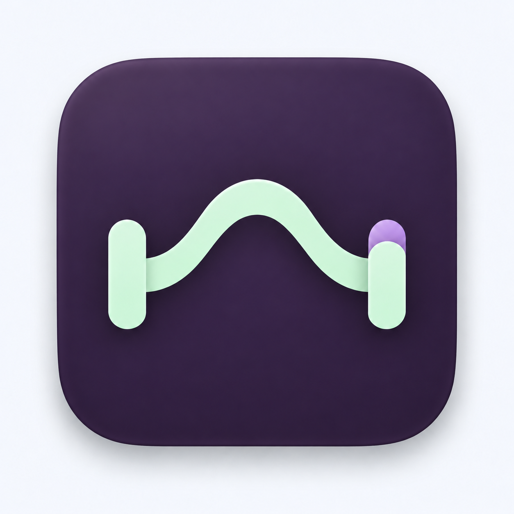
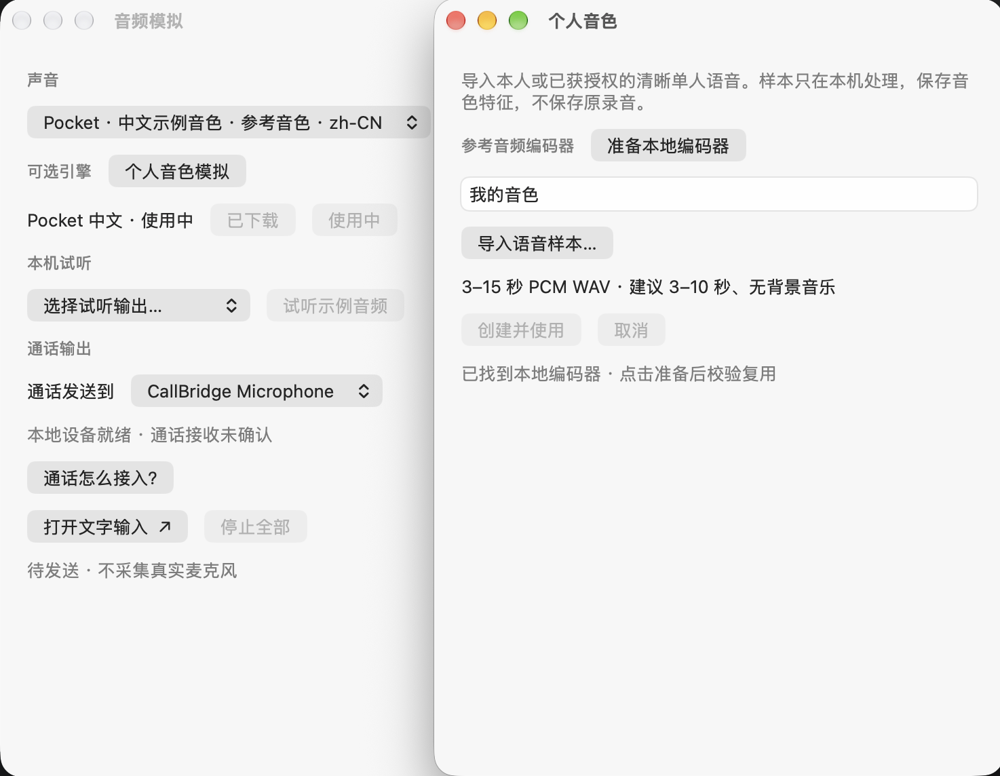

<h1 align="center">CallBridge</h1>

Let your imagination into the call.

<a href="README.md">简体中文</a> · English · <a href="https://storyon403-afk.github.io/CallBridge/">Website (coming soon) ↗</a>

## The idea

Sometimes you can listen, but can't speak. Type your reply and let CallBridge say it for you. Choose a voice, add background sound, or join the conversation as a virtual character.

## Demos

Imagine you're in a WeChat voice or video call. The left shows what you do; the right shows the result.

### Type to speak

Choose a voice, type a message, and send.

<table>
  <tr><th align="center">Workflow</th><th></th><th align="center">WeChat result · play with sound</th></tr>
  <tr>
    <td width="68%" align="center"></td>
    <td align="center">➜</td>
    <td width="28%" align="center"><video src="https://github.com/user-attachments/assets/0d8db882-baf1-42c4-821b-f8bd6201967d" controls width="220"></video>

Local playback
<video src="assets/demos/effect-01-local.mp4" controls preload="metadata" width="220" poster="assets/demos/effect-01-poster.jpg"></video> <a href="assets/demos/effect-01.mp4">Original MP4</a>
</td>
  </tr>
</table>

### Background audio

Import a track and keep it playing between messages.

<table>
  <tr><th align="center">Workflow</th><th></th><th align="center">WeChat result · play with sound</th></tr>
  <tr>
    <td width="68%" align="center"></td>
    <td align="center">➜</td>
    <td width="28%" align="center"><video src="https://github.com/user-attachments/assets/85355be9-8953-433e-b3a4-9416ec31eed1" controls width="220"></video>

Local playback
<video src="assets/demos/effect-02-local.mp4" controls preload="metadata" width="220" poster="assets/demos/effect-02-poster.jpg"></video> <a href="assets/demos/effect-02.mp4">Original MP4</a>
</td>
  </tr>
</table>

### Live ambience

Mix live ambient sound with synthesized speech.

<table>
  <tr><th align="center">Workflow</th><th></th><th align="center">WeChat result · play with sound</th></tr>
  <tr>
    <td width="68%" align="center"></td>
    <td align="center">➜</td>
    <td width="28%" align="center"><video src="https://github.com/user-attachments/assets/300ca28b-fbdd-4efe-834b-8bb7aacbda1c" controls width="220"></video>

Local playback
<video src="assets/demos/effect-03-local.mp4" controls preload="metadata" width="220" poster="assets/demos/effect-03-poster.jpg"></video> <a href="assets/demos/effect-03.mp4">Original MP4</a>
</td>
  </tr>
</table>

### Personal voice

### Avatar · Background

Coming soon.

---

[ftop](https://github.com/Nongfsq/ftop)
