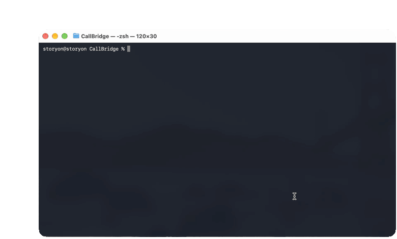
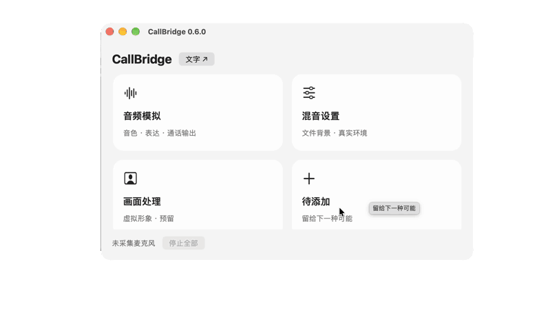
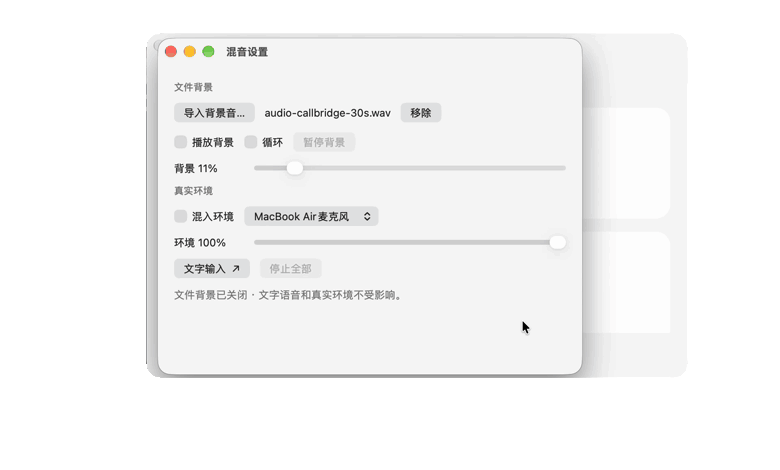

<h1 align="center">CallBridge</h1> 

通话时发挥你的想象。

 通话辅助工具：通过虚拟麦克风传递合成语音，通过虚拟摄像头传递处理后的画面。通话软件继续负责通话，CallBridge 负责你想让对方听见和看见的内容。

[技术图解](graph.md) · [构建](#构建) · [使用](#使用) · [开发](#开发)

> [!WARNING]
> **声明：**
> 以下所有叙述均不能代表该demo日后的实际设计，只是概念展示，用于该idea解释

## 产品设计

项目idea由来：

更好的交流：你必须在安静的环境中与别人进行交流，你可以带耳机听别人讲，自己打字转语音给别人听，在这个过程中你可以选择你周围的环境不影响你的通话以及你的隐私，或许你周围太吵，或许对方需要你这边安静的环境声音。

更有趣的互动：
摄像头捕捉真实人物形象，进行虚拟形象替换。还可以进行背景替换，甚至服装替换。

你可以在微信通话，facetime,discord 音频会议，腾讯会议，钉钉会议等上实现上述效果。


## 展示

以下以微信通话为例：左侧是 CallBridge 操作流程，右侧是对应的效果录屏。点击右侧播放器观看效果，并点击播放器的扬声器图标取消静音（GitHub 默认静音）；点击左侧 GIF 可放大查看。窗口设计借鉴[ftop](https://github.com/Nongfsq/ftop)的优美设计,可以缩放窗口。

本地用 VS Code / Cursor 预览时，展开右侧的 **本地播放**，再点击播放按钮；无需联网。

### 文字转语音

选择音色与通话输出，输入文字并发送。

<table>
  <tr><th align="center">操作流程</th><th></th><th align="center">微信端效果 · 播放并取消静音</th></tr>
  <tr>
    <td width="68%" align="center"><a href="assets/demos/operation-01.gif"></a></td>
    <td align="center">➜</td>
    <td width="28%" align="center"><video src="https://github.com/user-attachments/assets/0d8db882-baf1-42c4-821b-f8bd6201967d" controls width="220"></video><details><summary>本地播放</summary><video src="assets/demos/effect-01-local.mp4" controls preload="metadata" width="220" poster="assets/demos/effect-01-poster.jpg"></video><br><a href="assets/demos/effect-01.mp4">原始 MP4</a></details></td>
  </tr>
</table>

### 自定义背景音

导入本地音频并开启背景播放，可以自定义传递背景氛围。

<table>
  <tr><th align="center">操作流程</th><th></th><th align="center">微信端效果 · 播放并取消静音</th></tr>
  <tr>
    <td width="68%" align="center"><a href="assets/demos/operation-02.gif"></a></td>
    <td align="center">➜</td>
    <td width="28%" align="center"><video src="https://github.com/user-attachments/assets/85355be9-8953-433e-b3a4-9416ec31eed1" controls width="220"></video><details><summary>本地播放</summary><video src="assets/demos/effect-02-local.mp4" controls preload="metadata" width="220" poster="assets/demos/effect-02-poster.jpg"></video><br><a href="assets/demos/effect-02.mp4">原始 MP4</a></details></td>
  </tr>
</table>

### 真实环境音混合

开启麦克风环境音，输入文字，可以选择让合成语音与真实环境共同输出。

<table>
  <tr><th align="center">操作流程</th><th></th><th align="center">微信端效果 · 播放并取消静音</th></tr>
  <tr>
    <td width="68%" align="center"><a href="assets/demos/operation-03.gif"></a></td>
    <td align="center">➜</td>
    <td width="28%" align="center"><video src="https://github.com/user-attachments/assets/300ca28b-fbdd-4efe-834b-8bb7aacbda1c" controls width="220"></video><details><summary>本地播放</summary><video src="assets/demos/effect-03-local.mp4" controls preload="metadata" width="220" poster="assets/demos/effect-03-poster.jpg"></video><br><a href="assets/demos/effect-03.mp4">原始 MP4</a></details></td>
  </tr>
</table>

画面替换效果：待补充。


## 构建

本机音频演示 App 的构建要求：Apple Silicon、macOS 26+、Apple Command Line Tools、Rust，以及callbridge 虚拟音频引擎 （先前计划的[BlackHole 16ch/2ch](https://github.com/ExistentialAudio/BlackHole)经实测未知bug不可行,待以后详细探索）。设备设为 48 kHz，系统安装 Tingting 或 Samantha 语音。

在项目根目录运行：

```sh
./CB build
./CB
```

也可双击 `rust/build/app/CallBridge.app`。在当前终端执行 `export PATH="$PWD:$PATH"` 后，可直接用 `CB` 启动；不需要修改系统目录。

构建脚本离线编译并进行本地 ad-hoc 签名；不安装音频驱动，不更改系统默认设备，不生成公证发行包。

目前正在学习和必要测试，以下所有将在该demo实际可展示和使用后提供。

## 使用

- `./CB` 打开主面板；四个入口随窗口宽度排列，小窗可滚动访问。
- 在“音频模拟”选择音色与通话输出，在“混音设置”管理文件背景和真实环境。
- `./CBT` 打开或关闭独立文字浮窗，沿用本次应用设置；主面板关闭后仍可输入发送。
- 关闭文字窗会停止全部声音；再次打开保留草稿，不自动发送。更新后先退出旧 App，再启动。


## 边界


## 开发
[demo进度](schedule.md)

## 参考

[ftop：README 以及后来ui参考](https://github.com/Nongfsq/ftop) · [Apple：Core Audio 数据流](https://developer.apple.com/library/archive/documentation/MusicAudio/Conceptual/CoreAudioOverview/ARoadmaptoCommonTasks/ARoadmaptoCommonTasks.html) · [BlackHole：应用间音频回环](https://github.com/ExistentialAudio/BlackHole)
