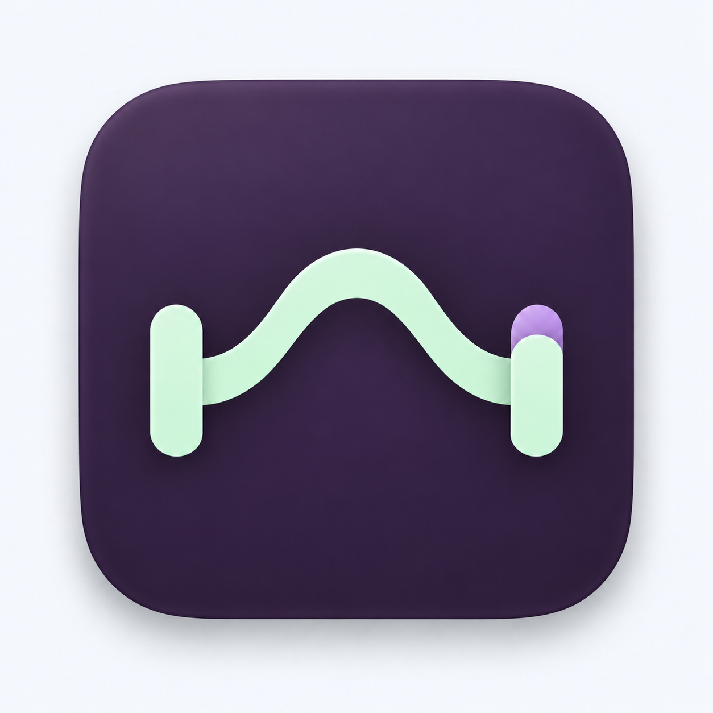

<p align="center"></p>
<h1 align="center">CallBridge</h1>
<p align="center">Type it. Say it. Join the call.</p>
<p align="center">English · <a href="README.zh-CN.md">简体中文</a> · <a href="https://storyon403-afk.github.io/CallBridge/">See it in action ↗</a></p>

CallBridge turns typed messages into speech for your calls. Choose a voice, add background sound, or use a virtual character and a different video background.

**Version 0.0.2 · Apple Silicon Mac · macOS 26 or later.**

## Get started

1. Download the App ZIP from [Releases](https://github.com/storyon403-afk/CallBridge/releases), unzip it, and move **CallBridge.app** to Applications. You can also [build from source](GETTING_STARTED.md#build-from-source).
2. Open CallBridge and choose a system voice. No voice model download is needed to begin.
3. Open **Text input**, type your message, and click the small arrow on the right. Choose **Preview text** to hear it through your speakers or headphones.
4. To use it in a call, [set up the call app's microphone](GETTING_STARTED.md#audio). For video, use [OBS Virtual Camera](GETTING_STARTED.md#video).

The App has not been signed or notarized by Apple. macOS may show a warning when you first open it. See the [opening instructions](GETTING_STARTED.md#install-the-app).

## A small panel beside your call

- Resize the text bar by dragging an edge. Move it with the six-dot handle on the left or its title bar.
- The arrow on the right shows voice settings, preview, volume, and permission to send.
- Shrink a panel and release to turn it into a floating widget. Double-click the widget to bring it back; your draft stays there.
- Choose a solid or translucent background in the main panel.
- Choose **简体中文 / English / 日本語** from the CallBridge menu, then quit and reopen the App.
- **⌘↩** sends; **⌘.** stops. Enter adds a new line.

[Full instructions](GETTING_STARTED.md) · [Plugins](plugins/official/README.md) · [Make a plugin](插件接入教程.md)

## Build and launch

```sh
git clone https://github.com/storyon403-afk/CallBridge.git
cd CallBridge
```

Follow the [build instructions and command setup](GETTING_STARTED.md#build-from-source). Then use `cb` for the main panel and `cbt` for the text bar from any folder.

Plugins supply the voices and visual effects; CallBridge connects supported plugins to your call. Model downloads and virtual audio/video devices are installed separately.

## License

[PolyForm Noncommercial 1.0.0](LICENSE) permits personal and other allowed noncommercial use. Third-party components keep their own licenses. See [license details](LICENSING.md).

UI inspiration: [ftop](https://github.com/Nongfsq/ftop).
