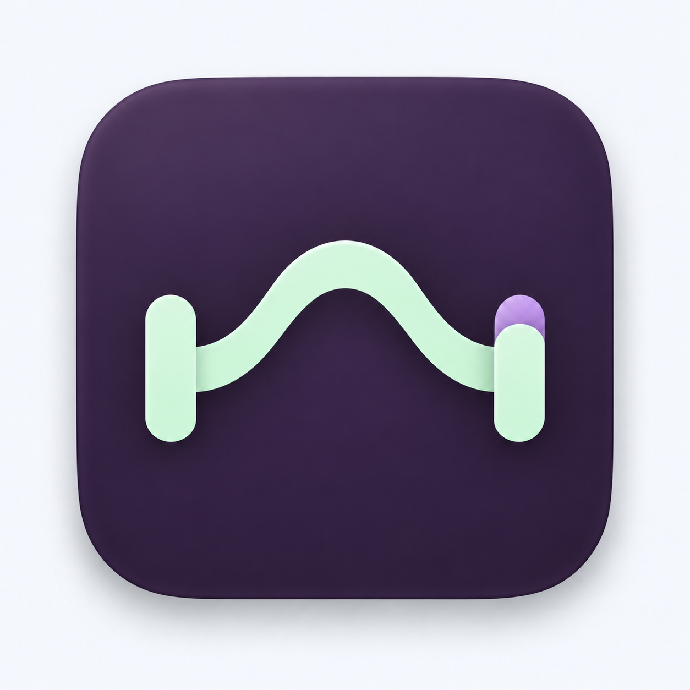

<p align="center"></p>
<h1 align="center">CallBridge</h1>
<p align="center">打字说话，轻松加入通话。</p>
<p align="center"><a href="README.md">English</a> · 简体中文 · <a href="https://storyon403-afk.github.io/CallBridge/">看看效果 ↗</a></p>

CallBridge 可以把你打的字变成语音，送进通话。你还可以换声音、加背景音，或者用虚拟人物和不同背景参加视频通话。

**正式版本 0.0.5 · macOS 26+（Apple Silicon）与 Windows 11 x64。**

Windows 提供[便携包、使用与构建说明](rust/windows/README.md)，包含系统语音、文件混音和虚拟人物画面输出。Pocket/个人音色、插件安装、常驻环境混音、云端操作和自动更新目前仅在 macOS 版提供。

两个平台现在都从「我的通话组合」开始。在「组合台」搭配人物与背景，在「接线台」选择试听和通话设备。[下载 CallBridge 0.0.5 正式版](https://github.com/storyon403-afk/CallBridge/releases/tag/v0.0.5)。

## 怎么开始

1. 到 [Releases](https://github.com/storyon403-afk/CallBridge/releases) 下载对应平台的 ZIP。Mac 解压后把 **CallBridge.app** 拖进“应用程序”；Windows 完整解压后打开 **CallBridge.exe**。也可以[自己从源码构建](GETTING_STARTED.md#中文使用流程)。
2. 打开 CallBridge，先选一个系统音色，不用先下载语音模型。
3. 点击「打字说话」，输入想说的话，点击右侧小箭头，再点“试听这段”，用扬声器或耳机听听效果。
4. 要让通话对方听到，请按[使用说明](GETTING_STARTED.md#中文使用流程)配置虚拟麦克风；要输出画面，则使用 OBS Virtual Camera。

App 尚未经过苹果发布签名和公证，第一次打开时系统可能提示拦截。[打开方法](GETTING_STARTED.md#中文使用流程)见使用说明。

## macOS 通话时怎么操作

- 拖窗口边缘调整输入框大小；拖左侧六点把手或标题栏移动位置。
- 点右侧箭头，展开试听、音量和发送许可等设置。
- 把窗口继续拖小，松手后变成悬浮小组件；双击小组件恢复，刚才的文字还在。
- 在主面板切换实色或半透明背景。
- 在 CallBridge 菜单选择中文、英文或日文，退出后重新打开生效。
- **⌘↩ 发送，⌘. 停止，Enter 换行。**

[完整使用说明](GETTING_STARTED.md#中文使用流程) · [下载和导入插件](plugins/official/README.md) · [制作插件](插件接入教程.md)

## 从源码安装

```sh
git clone https://github.com/storyon403-afk/CallBridge.git
cd CallBridge
```

按[构建步骤](GETTING_STARTED.md#build-from-source)准备依赖并设置命令。设置好以后，在任意目录输入 `cb` 打开主面板，输入 `cbt` 打开或关闭文字框。

声音和画面效果由插件提供，CallBridge 负责把支持的插件接进通话。语音模型、虚拟音频设备和 OBS 需要按需另行安装。

## 使用许可

[PolyForm Noncommercial 1.0.0](LICENSE)：允许个人及许可范围内的非商业使用，不授予商业使用权。第三方组件仍按各自许可使用。详见[许可说明](LICENSING.md)。

界面参考：[ftop](https://github.com/Nongfsq/ftop)。
