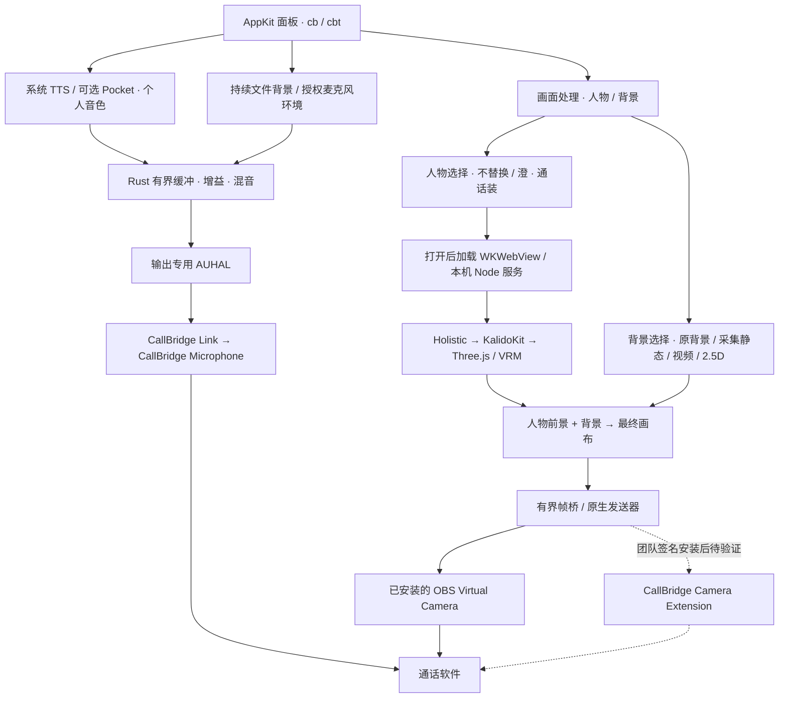

# CallBridge 技术图解

对应 0.10.1。图中实线表示当前实现，虚线表示仍需签名安装的自有摄像头路线；客户端是否收到须独立验证。

TTS、环境音和文件背景独立控制；背景不等待语句播放。形象资源按需安装，安装完成后另行打开。TTS 口型、通用背景/角色导入尚未接入。具体边界见 [架构](docs/VIDEO_CALL_DESIGN.md)。

## 普通通话的声音路径

这张图解释麦克风到远端的基础过程；CallBridge 的纯 TTS 模式从数字合成开始，不经过物理麦克风。

