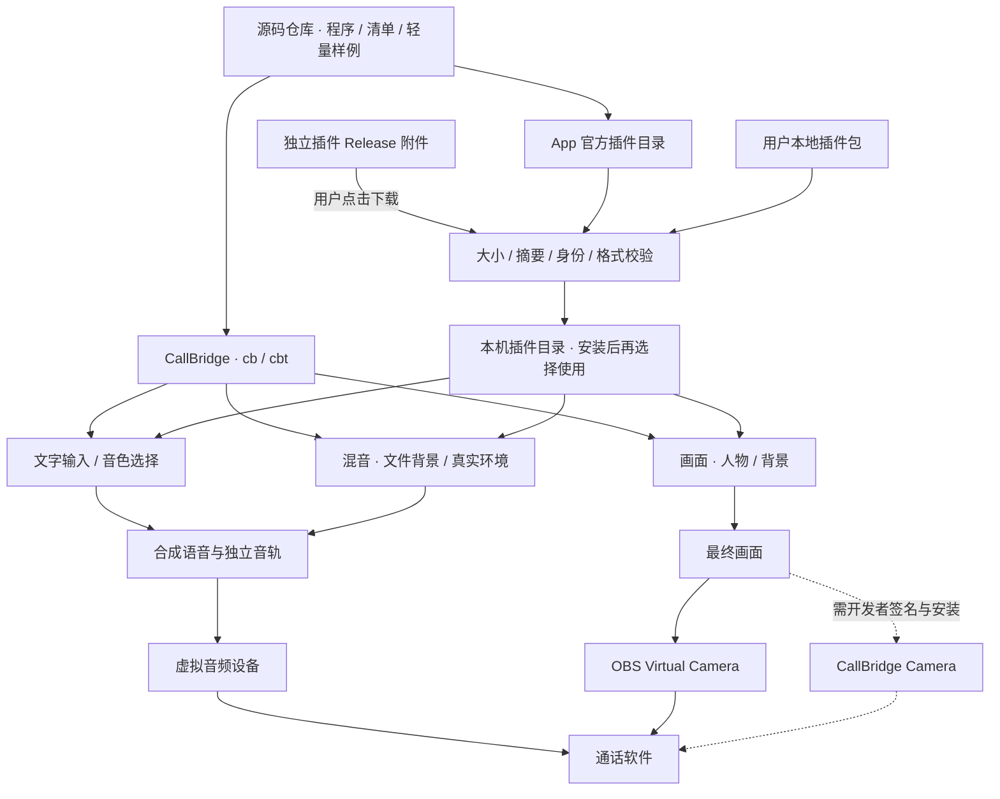
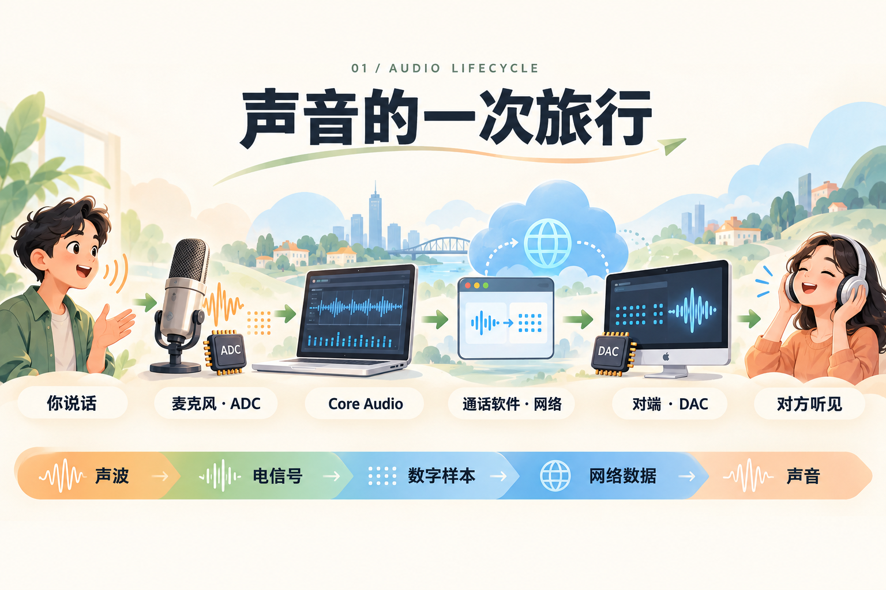

# CallBridge 功能接入图

对应 0.0.2。CallBridge 负责插件接入与通话输出；模型效果由各插件提供。

文件背景持续播放，不等待一句话合成。现已支持音色、指定降噪、VRM 角色与图片／视频背景导入；新模型需要对应适配器。TTS 口型和真人替换仍未完成。

官方插件显示“待发布”时暂时不能下载。视频通话使用 OBS Virtual Camera；自有摄像头需要另外的开发者签名和安装配置。

使用见 [GETTING_STARTED](GETTING_STARTED.md)，插件见 [官方目录](plugins/official/README.md)与[接入教程](插件接入教程.md)。上传范围见 [RELEASING](RELEASING.md#github-上传范围)。

## 普通通话的声音路径

下面说明真实麦克风到接收端的基础过程；CallBridge 的纯文字语音从数字合成开始，不经过物理麦克风。

